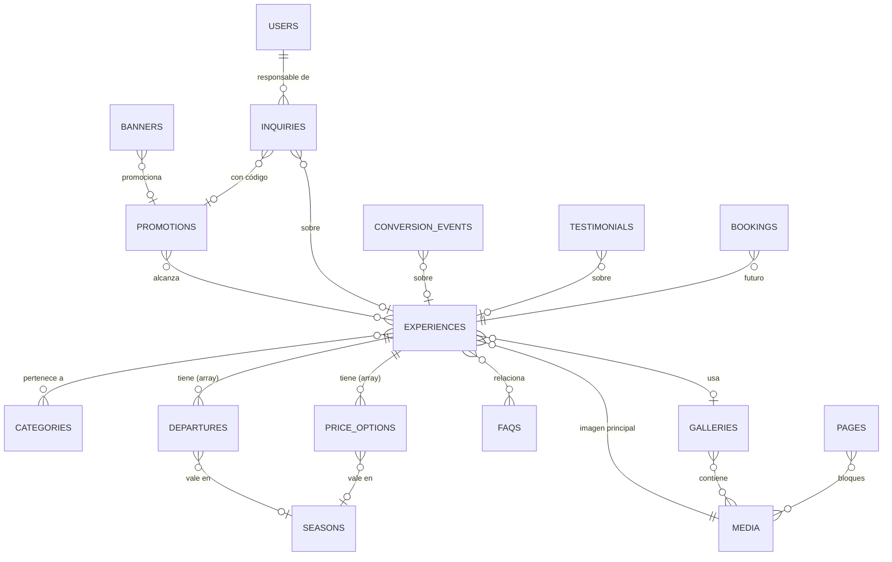

# DATA-MODEL — Entidades y relaciones

> Implementación: colecciones y globals de Payload 3 en `src/collections/` y `src/globals/`. Base de datos: PostgreSQL (adapter `@payloadcms/db-postgres`, migraciones versionadas en `src/migrations/`).
> Localización: activada desde el día 1 con un solo idioma (`es`). Los campos marcados **(L)** son localizables, así sumar `en`/`pt` no requiere migrar datos.
> Moneda: ARS. Montos en enteros (pesos, sin centavos). Zona horaria: `America/Argentina/Cordoba`.

---

## 1. Diagrama

## 2. Colecciones

### 2.1 `users` — Usuarios del panel
| Campo | Tipo | Notas |
|---|---|---|
| email | email (auth) | único |
| name | text | |
| role | select: `admin` · `editor` | default `editor` |
| — | auth de Payload | `maxLoginAttempts: 5`, `lockTime: 10 min`, `tokenExpiration: 8 h` |

### 2.2 `media` — Imágenes y videos
| Campo | Tipo | Notas |
|---|---|---|
| file | upload | imágenes (jpg, png, webp, avif) y video (mp4, webm) |
| alt | text **(L)** | **obligatorio** |
| caption | text **(L)** | |
| credit | text | autor de la foto |
| register | select: `paisaje` · `experiencia` · `detalle` · `equipo` · `obra` | brandbook 07.01 |
| focalPoint | nativo | para recortes |
| tags | text[] | |
| sizes | generadas | `thumb 400`, `card 800 (4:5)`, `hero 1920`, `hero-mobile 1080×1920`, `og 1200×630` |

### 2.3 `galleries` — Galerías
nombre (L), slug, imágenes (relación ordenable a `media`), portada.

### 2.4 `categories` — Categorías de experiencias
nombre (L), slug, descripción (L), orden.

### 2.5 `seasons` — Temporadas
| Campo | Tipo | Notas |
|---|---|---|
| name | text (L) | "Temporada alta 2026–27" |
| slug | text | |
| ranges | array de { desde: date, hasta: date } | una temporada puede tener varios rangos (ej. fines de semana largos) |
| priority | number | si dos temporadas se superponen, gana la de mayor prioridad |

### 2.6 `experiences` — Experiencias *(entidad central)*
| Campo | Tipo | Notas |
|---|---|---|
| title | text (L) | "Golden Hour" |
| slug | text, único | |
| availability | select: `active` · `coming_soon` · `paused` · `archived` | Estado comercial; solo `active` y `coming_soon` se ven en el sitio. No se llama `status` para no chocar con `_status` (borrador/publicado) de Payload |
| categories | relación múltiple → `categories` | |
| occasions | select múltiple: `pareja` · `amigos` · `familia` · `grupos` · `empresas` | filtros de `/experiencias` |
| timeOfDay | select: `manana` · `mediodia` · `tarde` | **sin "noche"**: operación diurna (Ley 11.005 art. 27) |
| featured, order | checkbox, number | |
| tagline | text (L) | bajada sensorial |
| description | richText (L) | |
| itinerary | array { time: text, title (L), text (L) } | "Cómo es la salida" |
| included | array { item (L) } | |
| extras | array { name (L), price: number, note (L) } | opcionales pagos |
| idealFor | text (L) | |
| importantInfo | richText (L) | |
| heroImage | upload → `media` | obligatorio si `active` |
| heroImageMobile | upload → `media` | recorte vertical |
| heroVideo | upload → `media` | opcional |
| gallery | relación → `galleries` | |
| durationMinutes | number | obligatorio si `active` |
| boardingPoint | text (L) | por defecto, el de Información general |
| capacity | number | lugares comerciales por salida |
| minGuests, minAge | number | |
| accessibility | richText (L) | |
| departures | array (ver §3.1) | |
| availabilityNote | group { text (L), expiresAt: date } | "Quedan 8 lugares el sábado"; se oculta al vencer |
| priceOptions | array (ver §3.2) | |
| priceFallbackText | text (L) | "Consultá el precio" |
| priceValidUntil | date | para datos estructurados |
| whatsappMessage | text (L) | plantilla con variables `{experiencia}`, `{ref}` |
| refCode | text | ej. `GH` → arma `EDL-GH-<canal>` |
| ctaLabel | text (L) | sobrescribe el CTA global |
| booking | group (ver §3.3) | **solo admin** |
| faqs | relación múltiple → `faqs` | |
| meta | group SEO (plugin) | title, description, image, noIndex |

### 2.7 `pages` — Páginas
título (L), slug, `layout` (blocks: ver CMS-SPECIFICATION §3.1), `meta` (SEO), borradores, versiones y publicación programada. Páginas fijas que también se gestionan acá: Home, Nosotros, El lago, Planificá tu visita, Privados y empresas, Contacto, legales.

### 2.8 `faqs` — Preguntas frecuentes
pregunta (L), respuesta (richText L), categoría (select: reservas, clima, a bordo, seguridad, chicos y mascotas, accesibilidad, cómo llegar, privados), orden, mostrar en la página general sí/no.

### 2.9 `testimonials` — Testimonios
autor, origen (Google, TripAdvisor, Instagram, directo), fecha, texto (L), puntaje (1–5), experiencia (relación), **permiso de publicación** (checkbox obligatorio), enlace a la fuente.

### 2.10 `promotions` — Promociones
| Campo | Tipo | Notas |
|---|---|---|
| internalName | text | |
| title, body | text (L), richText (L) | |
| image | upload | |
| benefitType | select: `percent` · `amount` · `two_for_one` · `other` | |
| benefitValue | number | |
| code | text, único | `APERTURA15` |
| experiences | relación múltiple → `experiences` | vacío = todas |
| startsAt, endsAt | date (con hora) | |
| enabled | checkbox | pausa manual |
| featuredOnHome, priority | checkbox, number | |
| hasLanding, slug | checkbox, text | `/promociones/[slug]` |
| terms | richText (L) | condiciones |
| cta | group { label (L), href } | |
| status | **virtual** (calculado) | `scheduled` · `live` · `expired` · `paused` |

### 2.11 `banners` — Banners
nombre interno, placement (select: `top_bar` · `home_after_hero` · `experience_page` · `experiences_list`), texto (L), imagen, CTA, promoción (relación opcional), startsAt, endsAt, enabled, priority, estilo (`piedra` · `verde`).

### 2.12 `inquiries` — Consultas
| Campo | Tipo | Notas |
|---|---|---|
| type | select: `experience` · `corporate` · `general` · `waitlist` · `gift` | |
| name | text | obligatorio |
| phone | text | obligatorio salvo email presente; normalizado a E.164 (+54…) |
| email | email | |
| experience | relación → `experiences` | |
| requestedDate | date | |
| guests | number | |
| occasion | select: `cumpleanos` · `aniversario` · `propuesta` · `amigos` · `familia` · `empresa` · `otra` | |
| eventType, company, taxId, budget | text / number | corporativo |
| message | textarea | |
| interest | text | lista de espera |
| promotion | relación → `promotions` | si vino con código |
| source | group (solo lectura) | `pagePath`, `ctaLocation`, `referrer`, `utmSource`, `utmMedium`, `utmCampaign`, `utmContent`, `utmTerm`, `gclid`, `fbclid`, `device`, `refCode` |
| status | select: `new` · `in_progress` · `proposal_sent` · `confirmed` · `lost` · `spam` | default `new` |
| assignee | relación → `users` | |
| internalNotes | textarea | |
| estimatedValue | number | |
| consentMarketing | checkbox | |
| privacyVersion | text | versión de la política aceptada |
| ipHash | text | hash (no IP en claro), para antispam |

Acceso: `create` solo desde el endpoint del sitio (servidor, con Turnstile); `read/update` admin y editor; `delete` solo admin.

### 2.13 `conversion-events` — Clics medidos
type (`whatsapp_click` · `phone_click` · `booking_click`), experience, ctaLocation, pagePath, refCode, UTM (group), device, createdAt. Solo lectura en el panel. Retención: 24 meses.

### 2.14 `redirects` — Redirecciones
Plugin oficial `@payloadcms/plugin-redirects`.

### 2.15 `bookings` — Reservas *(futuro, no se crea en el MVP)*
Se documenta para que el modelo no tenga que cambiar:
`provider`, `externalId`, `experience`, `departureAt`, `guests` (por tipo), `amount`, `currency`, `status` (`pending` · `confirmed` · `cancelled` · `refunded`), `customer` (nombre, teléfono, email), `inquiry` (relación opcional, para unir consulta y reserva), `source` (mismo grupo que `inquiries`), `raw` (json del webhook).

## 3. Estructuras embebidas

### 3.1 `departures` (array dentro de `experiences`)
| Campo | Tipo | Notas |
|---|---|---|
| daysOfWeek | select múltiple (lun…dom) | |
| time | text `HH:mm` | validado: debe ser diurno (aviso si es posterior a la puesta del sol estimada) |
| season | relación → `seasons` | vacío = todo el año |
| note | text (L) | "Solo con reserva previa" |
| externalSlotId | text | **para el motor de reservas** |

### 3.2 `priceOptions` (array dentro de `experiences`)
| Campo | Tipo | Notas |
|---|---|---|
| passengerType | select: `adulto` · `menor` · `jubilado` · `residente` · `grupo` | |
| label | text (L) | "Menores de 3 a 10 años" |
| season | relación → `seasons` | vacío = todo el año |
| amount | number (ARS) | |
| isFromPrice | checkbox | el que se muestra como "desde" |
| externalRateId | text | **para el motor de reservas** |

### 3.3 `booking` (grupo dentro de `experiences`, solo admin)
| Campo | Tipo | Notas |
|---|---|---|
| mode | select: `inherit` · `contact` · `external_link` · `widget` | `inherit` toma el modo global |
| provider | select: `none` · `turitop` · `bokun` · `fareharbor` · `other` | |
| externalProductId | text | |
| externalUrl | text (URL) | para `external_link` |
| widgetConfig | json | parámetros del widget (nunca HTML o scripts libres) |

## 4. Globals

| Global | Contenido | Quién edita |
|---|---|---|
| `site-settings` | marca, endoso, datos legales, contacto, ubicación, credenciales, medios de pago, redes, SEO por defecto | admin, editor |
| `navigation` | menú principal, footer, CTA del header | admin, editor |
| `announcement` | aviso operativo con vencimiento | admin, editor |
| `integrations` | **modo del sitio**, GA4, Meta Pixel, modo de reserva global, proveedor, destinatarios de notificaciones | **solo admin** |

## 5. Reglas de negocio en el modelo

1. **Precio "desde"**: el menor `amount` con `isFromPrice` en la temporada vigente; si no hay, se muestra `priceFallbackText`.
2. **Temporada vigente**: la de mayor prioridad cuyo rango contiene la fecha actual (zona Córdoba).
3. **Promoción vigente**: `enabled` y `startsAt ≤ ahora < endsAt`. Al vencer, su landing redirige 302 a la primera experiencia alcanzada o a `/experiencias`.
4. **Modo de reserva efectivo** de una experiencia: `booking.mode` si no es `inherit`; si no, el modo global de `integrations`. Si el modo global es `preapertura`, todas las experiencias muestran "Enterate primero".
5. **Revalidación**: los hooks `afterChange` de cada colección revalidan los tags `experiences`, `experience:<slug>`, `promotions`, `settings`, etc.
6. **Borrado protegido**: no se borra una experiencia con consultas; se archiva.

## 6. Retención y privacidad de datos (Ley 25.326)

- Consultas: 24 meses desde la última actualización; luego se anonimizan (se borran nombre, teléfono y email, se conservan las métricas).
- Lista de espera: hasta 12 meses después del lanzamiento o hasta que la persona pida la baja.
- La IP no se guarda en claro.
- Derechos de acceso, rectificación y supresión: por email a la dirección de la política de privacidad; un admin puede exportar o borrar los datos de una persona.
- **[CONFIRMAR]** con el estudio jurídico la inscripción de la base de datos ante la AAIP.
