# ROADMAP — Etapas de implementación

> Las etapas están ordenadas por dependencia. Las fechas dependen de la fecha de inicio de operación (habilitaciones y botadura), que hoy no está confirmada; por eso se expresan en semanas relativas.
> **Regla del brandbook (10.01):** si la sesión de fotos no está lista, se corre el lanzamiento. Es preferible una intriga más larga que un lanzamiento con stock.

---

## Vista general

```mermaid
gantt
  dateFormat  X
  axisFormat  S%s
  section Etapa 0
  Validación y definiciones        :e0, 0, 2
  section Etapa 1 · MVP
  1A Fundaciones + CMS              :e1a, after e0, 2
  1B Preapertura (landing + lista) :e1b, after e1a, 1
  1C Sitio completo (modo consultas):e1c, after e1b, 4
  1D QA, contenidos, lanzamiento   :e1d, after e1c, 1
  section Etapa 2
  Segunda etapa                     :e2, after e1d, 6
  section Etapa 3
  Reservas online                   :e3, after e2, 6
```

---

## Etapa 0 — Validación y definiciones (semanas 1–2)

**Entregables**
- Revisión de esta documentación con SOYM; decisiones registradas.
- Respuestas a la lista de STRATEGY §13 (experiencias, horarios diurnos, precios, capacidad, embarque, contacto, políticas).
- Diseño en Figma de Home, Ficha de experiencia y Privados (desktop + mobile) sobre el design system.
- Cuentas creadas: GitHub, Vercel (Pro), Neon, Resend, Cloudflare (Turnstile), GA4, Search Console, Google Business Profile.
- DNS de `navegalosmolinos.com` accesible.
- Fecha de la sesión de fotos y video.

**Dependencias:** SOYM (datos comerciales), estudio jurídico (legales), brandbook (cerrado).
**Criterios de aceptación**
- [ ] STRATEGY, SITEMAP y CMS-SPECIFICATION aprobados.
- [ ] Diseños de las 3 páginas clave aprobados en Figma.
- [ ] Lista de experiencias definitiva, todas en horario diurno.
- [ ] Acceso a las cuentas y al DNS.

---

## Etapa 1 — MVP

### 1A · Fundaciones y CMS (semanas 3–4)
**Entregables**
- Proyecto Next.js 16 + Payload 3 + Postgres funcionando en local, preview y producción.
- Todas las colecciones y globals de DATA-MODEL con acceso por rol.
- Tokens del design system, fuentes, logos y componentes base (`Button`, `Chip`, `PriceBadge`, `Input`, `Accordion`, `SiteHeader`, `Footer`, `HorizonRule`, `OlaDivider`).
- Capa `src/lib/cms`, revalidación por tags, vista previa en vivo.
- Panel con la marca: logo e isotipo en el login y la navegación, colores de marca (hoy muestra el logo de Payload).
- Seed con contenido real disponible (no lorem ipsum).
- CI con lint, typecheck, tests y build.

**Dependencias:** Etapa 0.
**Criterios de aceptación**
- [ ] Un editor crea una experiencia y la ve en preview sin ayuda técnica.
- [ ] El rol editor no ve Integraciones ni Usuarios.
- [ ] Deploy a producción desde `main` con migraciones automáticas.
- [ ] Backups diarios funcionando (restauración probada una vez).

### 1B · Preapertura (semana 5)
**Entregables**
- Home en modo `preapertura` (marca, lago, barco en construcción, lista de espera).
- Formulario de lista de espera con Turnstile, consentimiento y exportación CSV.
- GA4 + Consent Mode + Search Console.
- Legales: privacidad y cookies.

**Dependencias:** 1A; textos legales; fotos del astillero.
**Criterios de aceptación**
- [ ] Alta en lista de espera llega al panel y por email en < 1 minuto.
- [ ] Evento `sign_up` visible en GA4 DebugView.
- [ ] Lighthouse mobile ≥ 90 en la Home.
- [ ] Puede publicarse en `navegalosmolinos.com` para la fase de Intriga del brandbook.

### 1C · Sitio completo en modo consultas (semanas 6–9)
**Entregables**
- Páginas: Home completa, Experiencias, Ficha, Privados y empresas, El lago, Planificá tu visita, Nosotros, FAQ, Contacto, Gracias, Legales, 404.
- Page builder con los bloques de CMS-SPECIFICATION §3.1.
- Formularios de experiencia, corporativo y general.
- WhatsApp medido (`/go/whatsapp`), barra fija mobile, botón flotante.
- Promociones y banners con fechas; aviso operativo.
- SEO técnico completo: metadata, sitemap, robots, OG dinámico, JSON-LD.
- Tablero inicial del panel (consultas y clics por origen).

**Dependencias:** 1B; **sesión de fotos**; precios y horarios confirmados (o texto alternativo).
**Criterios de aceptación**
- [ ] Todas las páginas del SITEMAP del MVP publicadas con contenido real.
- [ ] Marketing crea una promoción con fechas y aparece/desaparece sola.
- [ ] Una consulta guarda experiencia, fecha, personas, ocasión, página, CTA y UTM.
- [ ] Clic a WhatsApp registrado en el panel y en GA4, con código de referencia en el mensaje.
- [ ] Datos estructurados válidos en Rich Results Test.
- [ ] Accesibilidad AA (axe sin errores críticos) y navegación por teclado.
- [ ] Core Web Vitals en objetivo (SEO-STRATEGY §9) en Home y fichas.

### 1D · QA, carga de contenidos y lanzamiento (semana 10)
**Entregables**
- Pruebas e2e de los flujos F1–F5 (USER-FLOWS).
- Pruebas en dispositivos reales (iPhone, Android de gama media, desktop).
- Capacitación a Marketing (1 h) y `docs/GUIA-MARKETING.md`.
- Cambio de modo a `consultas` el día L del brandbook.

**Criterios de aceptación**
- [ ] Cero errores bloqueantes; Sentry sin errores nuevos 48 h después del lanzamiento.
- [ ] Marketing opera el sitio una semana sin pedir ayuda técnica.

---

## Etapa 2 — Funcionalidades de segunda etapa (después del lanzamiento, ~6 semanas)

| Funcionalidad | Valor | Dependencia |
|---|---|---|
| Testimonios y reseñas con fuente | Prueba social | Primeras salidas |
| Galería pública | Inspiración | 60+ fotos de marca |
| Guía del lago (`/guia`) | SEO de destino (pilar Educativo) | Contenidos |
| Regalá una salida (gift cards) | Consolidación del brandbook | Motor de reservas o códigos + Mercado Pago |
| Página de prensa y kit | Relación institucional | Material |
| Programa de alojamientos aliados (QR, códigos, página) | Canal de venta | Acuerdos |
| Inglés y portugués | Turismo internacional | Traducciones |
| Meta Pixel + Conversions API | Pauta medible | Inicio de pauta |
| Email marketing con base propia | Recurrencia | Consentimientos |
| Tablero de métricas dentro del panel | Autonomía de Marketing | Datos de 1C |

**Criterio general:** cada funcionalidad se activa sin tocar el diseño base ni el modelo de las experiencias.

## Evolución del CMS

| Etapa | Mejoras |
|---|---|
| MVP | Colecciones, roles, borradores, vista previa, programación, exportación CSV, tablero básico |
| 2 | Moderación de testimonios, plantillas de página, flujo de aprobación (Marketing propone, admin publica, para piezas de Marca y Promoción según brandbook 10.06), 2FA/SSO, guía de uso con capturas |
| 3 | Sincronización de disponibilidad y precios con el motor de reservas, vista de reservas, reportes de ocupación, unión consulta ↔ reserva, CRM liviano (historial por cliente) |

---

## Etapa 3 — Sistema de reservas (cuando la operación esté estabilizada)

**Precondiciones:** habilitaciones vigentes, una temporada operando por consulta (para conocer la demanda real), política de cancelación definida, facturación ARCA resuelta.

**Entregables**
- Selección del proveedor (INTEGRATIONS §3.2) con demo y prueba de pagos con Mercado Pago.
- Adaptador del proveedor en `src/lib/booking/`.
- Modo `reservas` activado por experiencia (empezando por la de mayor demanda).
- Webhook → colección `bookings` + `purchase` en GA4.
- Botón de arrepentimiento y términos de venta online.
- Manifiesto de pasajeros exportable para la operación.

**Criterios de aceptación**
- [ ] Una persona reserva y paga desde el celular en menos de 3 minutos.
- [ ] La reserva aparece en el panel con su origen (UTM) unido a la consulta si la hubo.
- [ ] Cambiar una experiencia de "consulta" a "reserva" no requiere cambios de diseño ni de contenido.
- [ ] WhatsApp sigue disponible como canal secundario.

## Integraciones futuras (resumen)
WhatsApp Cloud API (inbox, recordatorios 48 h/24 h) · channel manager y OTAs · TripAdvisor · pronóstico de viento para aviso operativo · CRM.

---

## Riesgos del proyecto

| Riesgo | Impacto | Mitigación |
|---|---|---|
| Habilitaciones demoradas | Alto | Modo preapertura indefinido; nada se vende antes |
| Sin fotos reales al lanzar | Alto | Correr L (brandbook); heros sólidos y fotos del astillero en preapertura |
| Precios no confirmados | Medio | Texto alternativo "Consultá el precio" |
| Contenido que contradice la ley (navegación nocturna) | Alto | Validación en el CMS; experiencias nocturnas fuera del sitio |
| Dependencia de una sola persona para operar el panel | Medio | Dos usuarios editores + guía escrita |
| Cambios en Payload (adquisición por Figma) | Bajo | Self-hosted, Postgres estándar, capa `lib/cms` |
