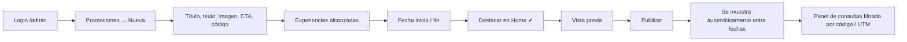
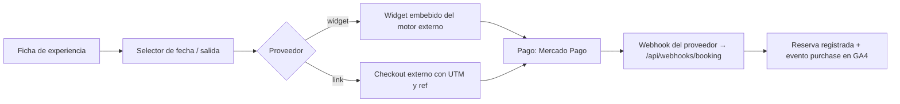

# USER-FLOWS — Recorridos principales

> Cada flujo indica el perfil (STRATEGY §3), la entrada, los pasos, la conversión, los eventos que se miden y los puntos de fricción a cuidar.

---

## F1 · Descubrir en Instagram y consultar por WhatsApp
**Perfil:** pareja que celebra / grupo de amigos. **Dispositivo:** mobile (≈ 80 % del tráfico esperado).

```mermaid
flowchart LR
  A[Reel o post en Instagram] --> B[Link en bio con UTM]
  B --> C[Ficha de experiencia]
  C --> D{¿Tiene dudas?}
  D -- No --> E[Barra fija: Consultar]
  D -- Sí --> F[Resumen / Qué incluye / Clima]
  F --> E
  E --> G[/go/whatsapp?exp=golden-hour&cta=sticky]
  G --> H[WhatsApp con mensaje precargado + código EDL-GH-IG]
  H --> I[Cierre humano con guion 02.05]
```

**Mensaje precargado (ejemplo):**
> Hola, quiero consultar por Golden Hour. Somos __ personas para el día __. (Ref. EDL-GH-IG)

**Eventos:** `page_view` → `view_item` (experiencia) → `whatsapp_click` {experience, cta_location, ref_code}.
**Fricción a cuidar:** que el link en bio no caiga en la Home; que la ficha cargue rápido en 4G (LCP < 2,5 s); que precio y qué incluye estén en el primer scroll.

---

## F2 · Planificar el viaje desde Google
**Perfil:** turista de otra provincia / familia. **Dispositivo:** desktop y mobile.

```mermaid
flowchart LR
  A["Google: 'paseo en barco lago los molinos'"] --> B[/experiencias o ficha]
  A2["Google: 'cómo llegar a ... embarque'"] --> P[/planifica-tu-visita]
  B --> P
  P --> B
  B --> C[Formulario contextual: fecha, personas, ocasión]
  C --> D[/gracias]
  D --> E[Notificación a SOYM: email + panel]
  E --> F[Respuesta por WhatsApp o email]
```

**Eventos:** `generate_lead` {form: experiencia, experience, date_requested, pax}.
**Fricción a cuidar:** mapa y dirección exactos, horario de check-in, qué pasa si llueve. El formulario no pide más de 6 campos obligatorios.

---

## F3 · Celebrar una ocasión
**Perfil:** pareja que celebra (aniversario, cumpleaños, propuesta).

```mermaid
flowchart LR
  A[Home] --> B[Filtro 'Pareja' en /experiencias]
  B --> C[Ficha Golden Hour]
  C --> D[Formulario: ocasión = Aniversario]
  D --> E[Campo opcional: '¿Querés que preparemos algo especial?']
  E --> F[/gracias]
```

**Dato para el equipo:** la ocasión llega en la consulta, así el guion de WhatsApp ya sabe qué preguntar ("¿Van a celebrar algo?").
**Eventos:** `generate_lead` {occasion: aniversario}.

---

## F4 · Empresa o grupo privado
**Perfil:** grupo corporativo (10–25) / celebración grande.

```mermaid
flowchart LR
  A["Google: 'evento empresa lago calamuchita'"] --> B[/privados-y-empresas]
  A2[Home: bloque Privados] --> B
  B --> C[Formulario corporativo]
  C --> D[/gracias?tipo=empresa]
  D --> E[Consulta con prioridad alta en el panel + email al comercial]
```

**Campos:** tipo de evento, fecha tentativa, personas, empresa (opcional), CUIT para factura (opcional), presupuesto estimado (opcional), necesidades, contacto.
**Eventos:** `generate_lead` {form: corporativo, pax, event_type}.

---

## F5 · Lista de espera (modo preapertura)
**Perfil:** audiencia de la fase de intriga (Córdoba Capital y Calamuchita).

```mermaid
flowchart LR
  A[Teaser en Instagram: 'Algo está llegando al lago'] --> B[/ o /lista-de-espera]
  B --> C[Formulario mínimo: nombre, WhatsApp, interés]
  C --> D[Consentimiento de comunicaciones]
  D --> E[Confirmación + 'te avisamos antes que a nadie']
  E --> F[Exportación CSV para difusión por WhatsApp]
```

**Meta del brandbook:** 300 contactos antes de revelar la marca.
**Eventos:** `sign_up` {method: waitlist}.
**Legal:** consentimiento explícito para recibir mensajes (Ley 25.326).

---

## F6 · Alojamiento o agencia que recomienda
**Perfil:** recepcionista de un hotel de Villa General Belgrano.

```mermaid
flowchart LR
  A[Huésped pregunta qué hacer] --> B[Recepción abre navegalosmolinos.com o QR del folleto]
  B --> C[/experiencias]
  C --> D[WhatsApp con ref del alojamiento: EDL-GH-HOTELX]
```

**Implementación:** QR por aliado con `?utm_source=alojamiento&utm_campaign=<aliado>` → el código de referencia llega al mensaje de WhatsApp y a la consulta.
**Fase 2:** página de aliados y comisión.

---

## F7 · Promoción de temporada (operación de Marketing)
**Actor:** persona de Marketing en el panel.



**Criterio de aceptación:** sin intervención de desarrollo, la promoción aparece y desaparece sola, y las consultas que llegan con su código se pueden filtrar y exportar.

---

## F8 · Cambio de precio o de horario
**Actor:** Marketing.

```mermaid
flowchart LR
  A[/admin → Experiencias → Golden Hour] --> B[Pestaña Precios: editar tarifa de temporada]
  B --> C[Pestaña Horarios: editar salida]
  C --> D[Guardar como borrador → vista previa → publicar]
  D --> E[La web se revalida en segundos]
```

**Criterio:** un dato, un lugar. El precio se edita una sola vez y se actualiza en la ficha, la tarjeta, la tabla comparativa y los datos estructurados.

---

## F9 · Cancelación por clima (aviso operativo)
**Actor:** Operaciones / Marketing.

```mermaid
flowchart LR
  A[Viento fuerte pronosticado] --> B[/admin → Ajustes → Aviso operativo]
  B --> C["Texto: 'Hoy no hay salidas por viento. Te escribimos para reprogramar.'"]
  C --> D[Vence a las 23:59]
  D --> E[Barra de aviso en todo el sitio]
```

---

## F10 · Reserva online (futuro, modo `reservas`)



**Clave:** la ficha, los CTA y la medición ya existen. Solo cambia el destino del botón (ver INTEGRATIONS.md §3).

---

## Mapa de eventos por flujo

| Flujo | Evento principal | Parámetros |
|---|---|---|
| F1 | `whatsapp_click` | experience, cta_location, ref_code, page_path |
| F2, F3 | `generate_lead` | form_type=experiencia, experience, pax, occasion |
| F4 | `generate_lead` | form_type=corporativo, pax, event_type |
| F5 | `sign_up` | method=waitlist, interest |
| F6 | `whatsapp_click` | ref_code con aliado |
| F7–F9 | (operación interna) | — |
| F10 | `begin_checkout` → `purchase` | value, currency=ARS, items |
